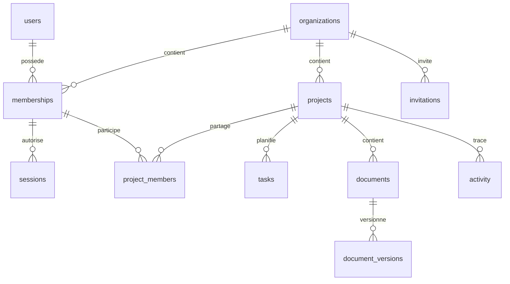

# Architecture et décisions initiales

## Choix

Monolithe modulaire : interface **React/TypeScript**, **Vite**, API HTTP JSON **Node.js 24**, base relationnelle **SQLite** locale via `node:sqlite`. Node 24 fournit ce module sans téléchargement d’un pilote natif ; son statut expérimental dans cette branche doit être pris en compte avant production. Aucun framework serveur ni ORM n’est ajouté pour ce premier périmètre.

React privilégie le web et ses composants accessibles. Flutter n’est pas retenu pour ce produit d’abord web, composé de formulaires, tableaux et interactions navigateur/document. Next.js apporte peu de bénéfice immédiat à une application authentifiée sans SEO ni rendu serveur nécessaire. Une enveloppe Tauri/Electron pourra réutiliser l’interface et consommer la même API ; une application mobile native restera un projet distinct partageant le contrat API et les règles métier.

SQLite permet un démarrage réellement persistant sans Docker ni compte externe. **La cible SaaS est PostgreSQL**, pas une ferme de serveurs partageant ce fichier. La migration nécessite un adaptateur asynchrone, la reprise des données et de nouveaux tests ; elle n’est pas déjà implémentée. L’API reste la frontière stable. Le stockage objet privé remplacera le disque local via un futur adaptateur. Pas de microservices à ce stade.

## Organisation

```text
src/                 Interface React, types métier, composants, vues
server/app.mjs       Routes API, validation, accès, journal transactionnel
server/security.mjs  Authentification, permissions, validateurs
server/database.mjs  Connexion et exécution transactionnelle des migrations
server/migrations/   Schéma SQL versionné
scripts/             Démarrage dev et serveur de tests isolé
test/                Intégration API et parcours E2E
docs/                Contrats, limites et décisions
```

Les routes complémentaires sont extraites dans `modules.mjs` et `accounts.mjs` ; les règles de planification, charge et modèles sont dans des modules dédiés. Les repositories PostgreSQL asynchrones restent une étape de production. Le serveur actuel utilise des requêtes préparées paramétrées ; aucune concaténation de donnée utilisateur dans le SQL.

## Modèle implémenté

Identifiants UUID stables. Dates métier ISO `YYYY-MM-DD`, horodatages UTC, montants entiers en centimes d’euro. Une inscription crée un utilisateur, une organisation et une appartenance administrateur dans une transaction. Le schéma accepte plusieurs appartenances mais l’interface et la connexion n’exposent pas encore le changement d’organisation.



Les clés étrangères composites `(org_id, project_id)` interdisent les liens de projet entre entreprises. Affectations et responsables référencent les appartenances de la même organisation. Les tâches jalons partagent la table `tasks` (`milestone=1`). Les contrôles applicatifs imposent l’appartenance de l’affectataire au projet. Les cinq rôles entreprise sont centralisés côté serveur. PMO : lecture transversale ; lecteur : lecture de ses projets autorisés ; contributeur : statut/progression de ses tâches et import documentaire de ses projets ; chef : création et gestion des projets dont il est responsable ; administrateur entreprise : gestion de tous les projets et invitations.

## Modèle étendu

Le schéma inclut désormais dépendances et hiérarchie, dossiers, commentaires, liens de documents aux tâches, validations documentaires par version, révisions et écritures budgétaires, événements, notifications, modèles, jetons de compte, journal de sécurité et disponibilités. Voir [la description du lot métier](business-release.md). Les tables de participants multiples, workflows de validation séquentiels, intégrations et administration commerciale restent à développer.

## Cohérence

Une tâche n’existe qu’une fois. Gantt, Kanban, liste et calendrier lisent la même API. Après mutation, les données sont rechargées. `revision` produit une erreur 409 si un client tente une mise à jour obsolète. Il n’y a pas encore de diffusion temps réel : les autres utilisateurs doivent recharger la page. L’historique projet est enregistré dans la même transaction que la mutation. Les fichiers sont écrits sous clé UUID ; en cas d’échec SQL le nouveau fichier est supprimé. Un arrêt brutal entre écriture et transaction peut laisser un fichier orphelin, à traiter avant industrialisation.
